# 🌐 Live Demos

Every example with a deployed frontend, recorded against Solana devnet and MagicBlock Ephemeral
Rollups. Each GIF shows real transactions; click a heading to open the live app.

| Example | Live demo | Source |
| ------- | --------- | ------ |
| [Counter](#counter) | [counter-example.magicblock.app](https://counter-example.magicblock.app) | [counter/anchor](./counter/anchor/) |
| [Private Counter](#private-counter) | [private-counter-example.magicblock.app](https://private-counter-example.magicblock.app) | [private-counter/anchor](./private-counter/anchor/) |
| [Session Keys](#session-keys) | [counter-session-keys-example.magicblock.app](https://counter-session-keys-example.magicblock.app) | [session-keys/anchor](./session-keys/anchor/) |
| [Roll Dice](#roll-dice) | [roll-dice.magicblock.app](https://roll-dice.magicblock.app) | [roll-dice/anchor](./roll-dice/anchor/) |
| [Binary Prediction](#binary-prediction) | [binary-prediction.magicblock.app](https://binary-prediction.magicblock.app) | [binary-prediction/anchor](./binary-prediction/anchor/) |
| [SPL Tokens](#spl-tokens) | [spl-demo.magicblock.app](https://spl-demo.magicblock.app) | [spl-tokens/anchor](./spl-tokens/anchor/) |
| [Rock Paper Scissor](#rock-paper-scissor) | [rps-example.magicblock.app](https://rps-example.magicblock.app) | [rock-paper-scissor/anchor](./rock-paper-scissor/anchor/) |
| [Rewards (Delegated VRF)](#rewards-delegated-vrf) | [magicblock-rewards-dashboard.vercel.app](https://magicblock-rewards-dashboard.vercel.app) | [rewards-delegated-vrf/anchor](./rewards-delegated-vrf/anchor/) |
| [Gasless Starter](#gasless-starter) | [gasless-starter.vercel.app](https://gasless-starter.vercel.app) | [gasless-starter/anchor](./gasless-starter/anchor/) |

## [Counter](https://counter-example.magicblock.app)

Increment on Solana, delegate the counter to an Ephemeral Rollup, increment there in ~150–300 ms
per transaction, then undelegate to commit the final count back to Solana.

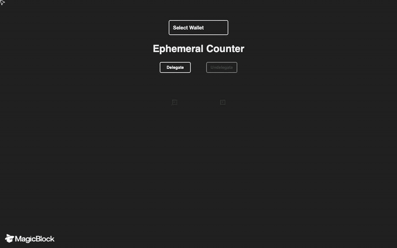

Screenshot

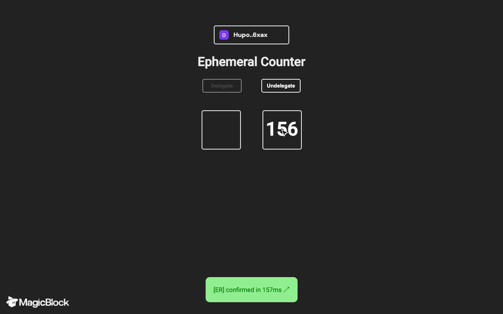

## [Private Counter](https://private-counter-example.magicblock.app)

The same counter on a TEE-backed Private Ephemeral Rollup. Flip the toggle to make the delegated
count private: only permitted readers see the value, everyone else sees it blurred.

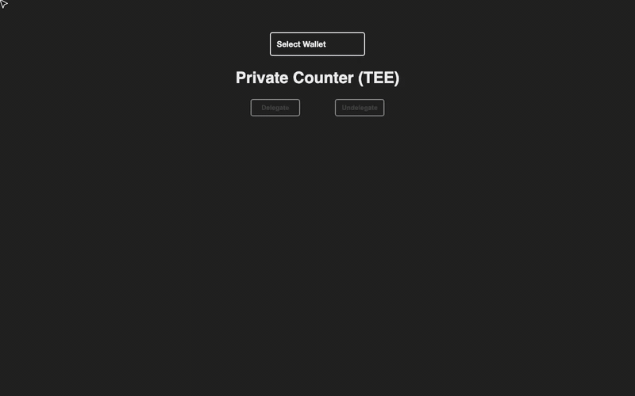

Screenshot

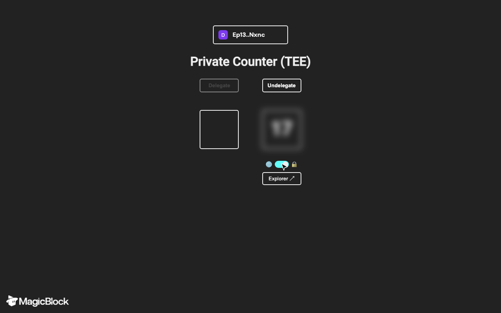

## [Session Keys](https://counter-session-keys-example.magicblock.app)

Approve one session with the wallet, then every increment on Solana and on the Ephemeral Rollup
is signed by the session key, with no further wallet prompts.

Screenshot

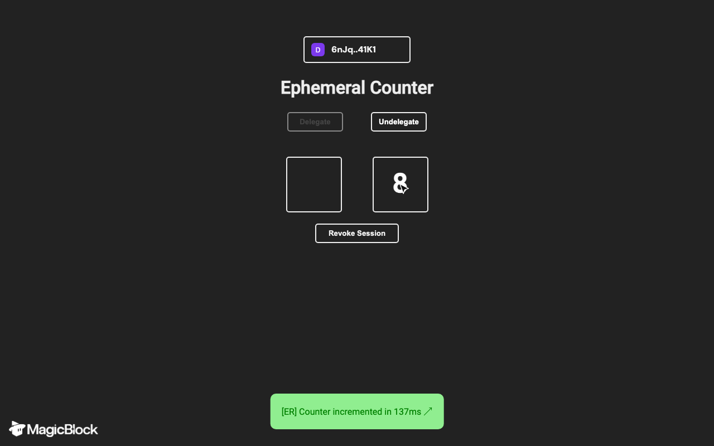

## [Roll Dice](https://roll-dice.magicblock.app)

The dice account is delegated to an Ephemeral Rollup. Each roll requests verifiable randomness
from the VRF oracle, and the result lands in under 200 ms.

Screenshot

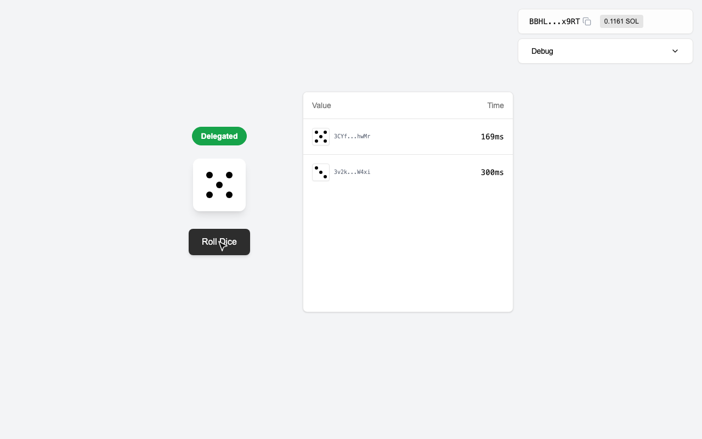

## [Binary Prediction](https://binary-prediction.magicblock.app)

Bet on whether SOL/USD goes up or down over a few seconds. The market runs on an Ephemeral Rollup
against a live price oracle; tickets and settlement are sent in ~50 ms.

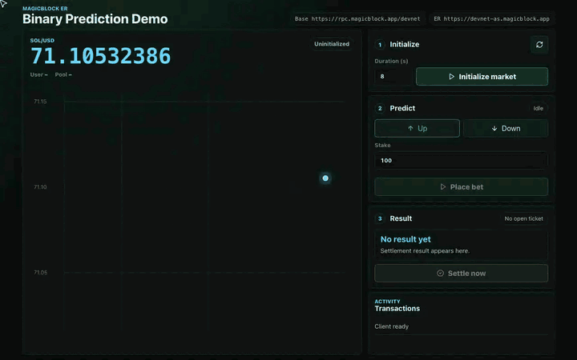

Screenshot

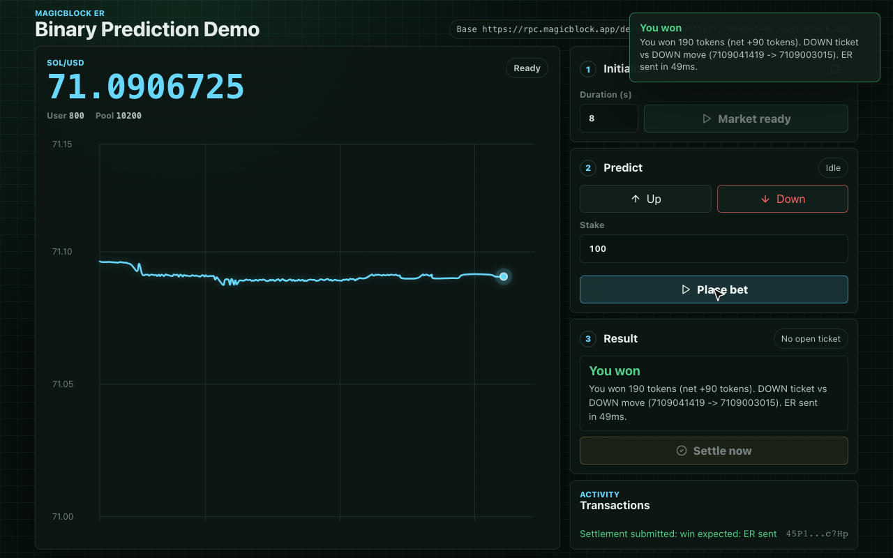

## [SPL Tokens](https://spl-demo.magicblock.app)

Delegate SPL token balances into ephemeral ATAs, transfer between accounts on the Ephemeral
Rollup, then undelegate and withdraw back to Solana.

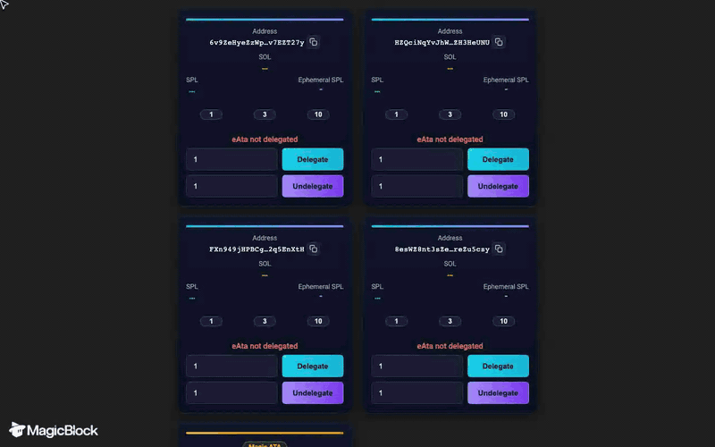

Screenshot

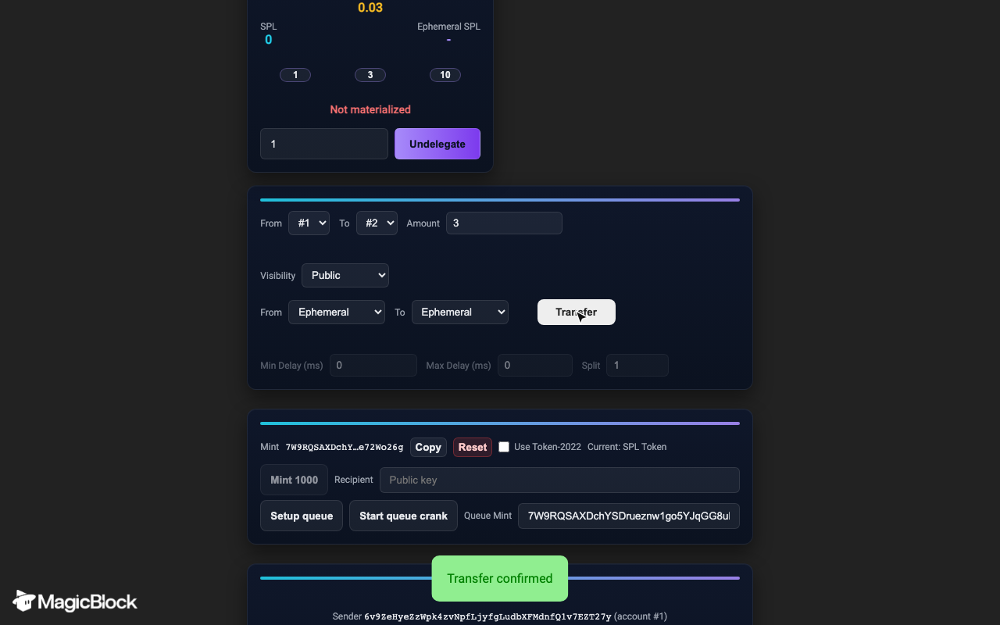

## [Rock Paper Scissor](https://rps-example.magicblock.app)

Play a best-of-three against a robot. Both moves stay private inside a TEE until the round is
revealed; the "Under the hood" log links every Solana and TEE transaction.

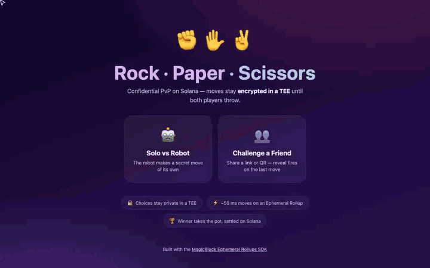

Screenshot

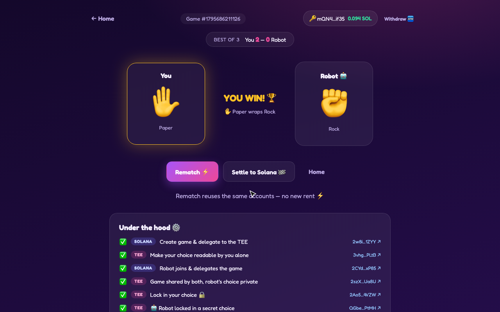

## [Rewards (Delegated VRF)](https://magicblock-rewards-dashboard.vercel.app)

Admin dashboard for a reward distributor: configure a reward list, delegate it to an Ephemeral
Rollup, and let VRF pick rewards for users. The recording connects a wallet, shows the distributor
and its schedule, tops up the callback escrow, and walks through the available actions.

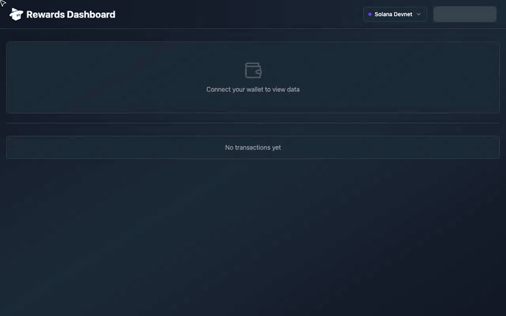

Screenshot

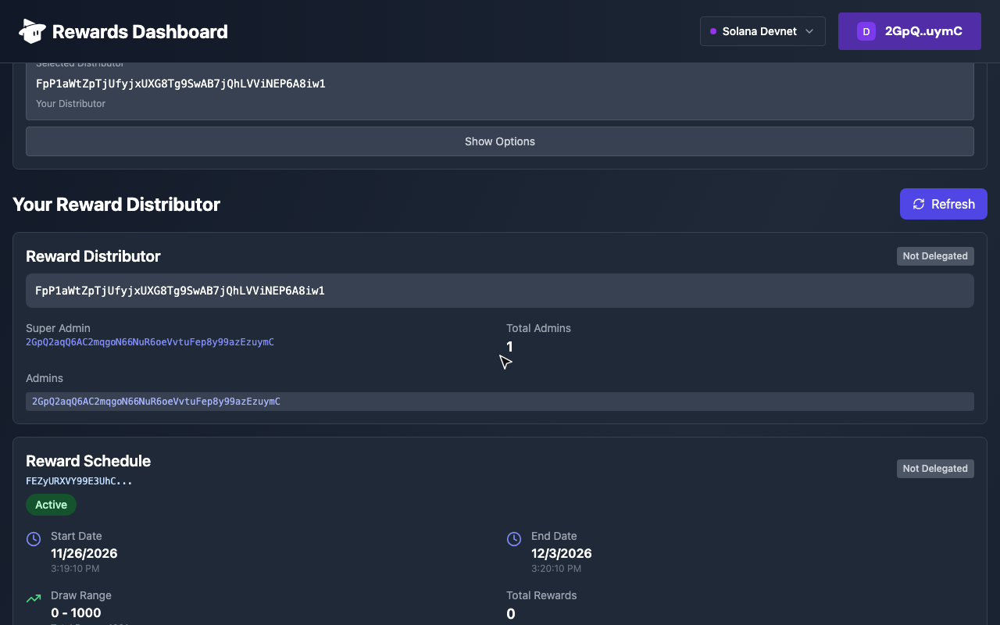

## [Gasless Starter](https://gasless-starter.vercel.app)

A wallet with zero SOL moves USDC onto an Ephemeral Rollup through the MagicBlock Payments API,
tips in ~100 ms on the rollup for free, and withdraws back to Solana. Each move costs a 0.20 USDC
relay fee instead of SOL gas.

Screenshot

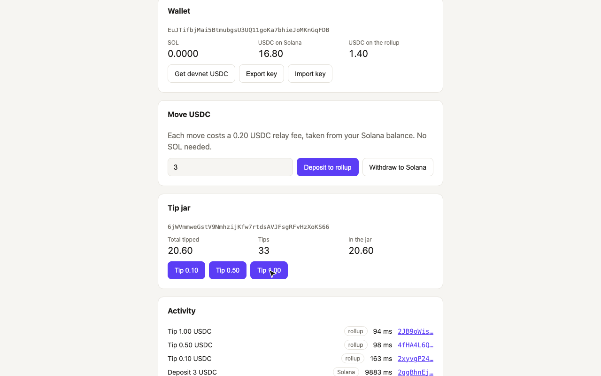

